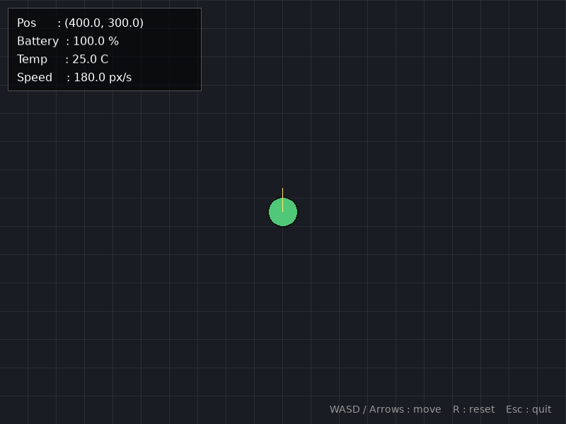
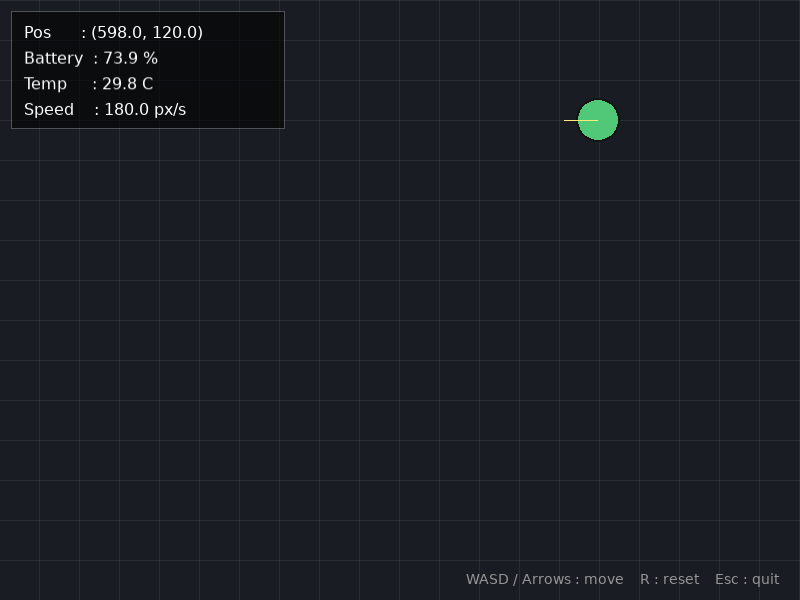
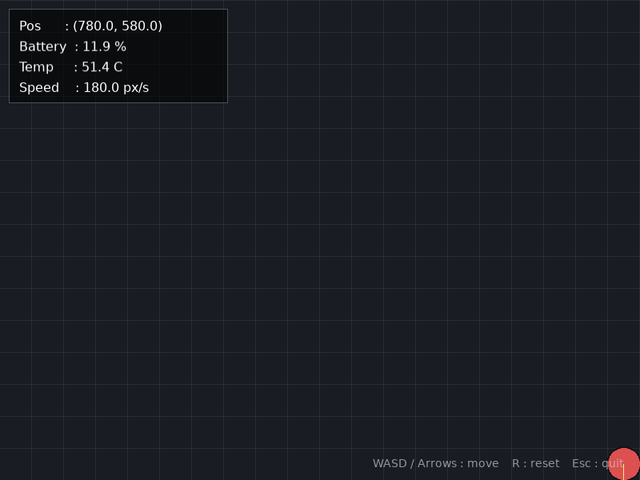

# SFML Robot Simulator


**SFML 3**로 만든 2D 로봇 시뮬레이터입니다. 키보드로 원형 로봇을 움직이면 배터리가 줄고 온도가 올라가는 모습을 HUD에서 실시간으로 볼 수 있습니다.
기능 자체보다 **C++ 빌드 과정(컴파일 → 정적 라이브러리 → 링크)을 직접 다루고, 일부러 낸 오류를 단계별로 분석한 것**에 초점을 둔 프로젝트입니다.

| 시작 | 이동 중 | 배터리 20% 이하 |
|:---:|:---:|:---:|
|  |  |  |
| 중앙 (400, 300), 100 %, 25 ℃ | 이동 → 배터리 감소, 온도 상승, 방향선 | 빨강으로 바뀜, 경계에서 멈춤 |

*스크린샷은 `main.cpp`의 그리기 함수를 그대로 써서 화면 밖(`sf::RenderTexture`)에서 렌더링했습니다.*

## 기능

- **이동**: `W/A/S/D` 또는 방향키로 상하좌우로 움직입니다. 이동량은 `속도 × dt`라서 프레임레이트와 상관없이 같은 속도로 움직입니다. `dt` 상한은 0.1초라 창을 드래그해서 멈췄다가 다시 시작해도 순간이동하지 않습니다.
- **배터리**: 100 px 이동할 때마다 5 %를 씁니다. 0 %가 되면 이동할 수 없습니다. 50 % 초과는 초록, 20–50 %는 노랑, 20 % 이하는 빨강으로 표시합니다.
- **온도**: 100 px 이동할 때마다 1.5 ℃ 오릅니다(최대 85 ℃). **정지해 있을 때만** 초당 6 ℃씩 식습니다(최저 25 ℃).
- **방향 지시선**: 진행 방향(도)을 직접 만든 정적 라이브러리 `libmathutils.a`의 `degreeToRadian`으로 라디안으로 바꾼 뒤 `cos`, `sin`으로 그립니다.
- **HUD**: 좌표, 배터리, 온도, 속도를 표시합니다. 폰트를 불러오지 못하면 HUD만 빼고 시뮬레이터는 계속 실행합니다.
- **조작**: `R` 리셋, `Esc` 종료

## 구조

```
MathUtils.cpp ──compile──▶ MathUtils.o ──ar rcs──▶ libmathutils.a ─┐
Robot.cpp     ──compile──▶ Robot.o ────────────────────────────────┼──link──▶ robot_sim (+ SFML 3 .so)
main.cpp      ──compile──▶ main.o ─────────────────────────────────┘
```

| 파일 | 역할 |
|---|---|
| `MathUtils.h` / `.cpp` | 각도 변환 라이브러리 (`mathutils::degreeToRadian`, `radianToDegree`) → `libmathutils.a` |
| `test_math.cpp` | 라이브러리 단위 테스트: 기준값 확인, 왕복 변환 오차 1e-9 이내, 결과 표 출력 |
| `Robot.h` / `.cpp` | 로봇의 상태와 이동 규칙만 담당 (캡슐화, 경계 클램프, 배터리·온도 규칙, `draw` 위임) |
| `main.cpp` | 창, 이벤트, 실시간 입력, `dt` 계산, 격자와 HUD 렌더링 |
| `hello_sfml.cpp` | SFML 3 설치 확인용 예제 (회전하는 원) |
| `Makefile` | `all` / `test` / `run` / `clean` 타겟. 헤더 의존성을 명시해 증분 빌드합니다 |
| `build.sh` | Makefile 없이 같은 빌드를 4단계 명령으로 실행합니다 |
| [`docs/REPORT.md`](docs/REPORT.md) | 실습 보고서: 환경, 빌드 명령, 오류 분석표, 배운 점, 질문 5개에 대한 답 |
| [`docs/BUILD_LOG.md`](docs/BUILD_LOG.md) | 모든 빌드 명령과 오류 원문을 단계(컴파일 / 링크 / 런타임)별로 기록한 로그 |

## 설계 포인트

- **책임 분리**: `Robot`은 상태와 규칙만, `main`은 창, 입력, 화면 구성만 맡습니다. 그리기는 `draw(sf::RenderTarget&) const`로 위임합니다. 그래서 같은 코드로 창 대신 텍스처(스크린샷)에도 그릴 수 있습니다.
- **include 최소화**
  - `Robot.h`는 `MathUtils.h`를 include하지 않습니다. 구현(`Robot.cpp`)에서만 쓰는 의존성이 헤더를 통해 퍼지지 않게 하기 위해서입니다.
  - 그 결과 `MathUtils.h`를 고쳐도 `main.o`는 다시 컴파일되지 않습니다. `g++ -MM`과 실제 증분 빌드로 확인했습니다.
- **컴파일 시점 검사**: 창 크기와 `Robot`의 필드 크기가 같은지 `static_assert`로 검사합니다.
- **방어적 프로그래밍**: 모든 setter가 유효 범위로 값을 제한합니다. `explicit` 생성자로 `float`에서 `Robot`으로의 암묵적 변환을 막습니다.
- **SFML 3 API**: `std::optional` 이벤트 루프, `event->getIf<>()`, `sf::Keyboard::Key::W`, `sf::Text(font, …)`, `sf::Vertex{}` 집합체 초기화처럼 2.x와 호환되지 않는 새 API만 씁니다.

## 빌드 실습에서 분석한 것

자세한 기록은 [`docs/REPORT.md`](docs/REPORT.md)와 [`docs/BUILD_LOG.md`](docs/BUILD_LOG.md)에 있습니다.

| 실험 | 단계 | 확인한 것 |
|---|---|---|
| `-lsfml-*` 누락 | 링크 | 헤더(선언)만 있고 정의가 없어서 `undefined reference` |
| 라이브러리를 소스 **앞에** 둠 | 링크 | 링커는 왼쪽에서 오른쪽으로 **한 번만** 훑고, 그때까지 해결되지 않은 심볼만 아카이브에서 꺼냄 |
| `-L.` 누락 / `-I.` 누락 | 링크 / 성공 | `"..."` include는 소스 파일의 디렉토리부터 찾으므로 `-I.`가 없어도 됨 |
| 라이브러리에 `main()` 추가 | 링크 | `multiple definition of 'main'` |
| `.a`를 `.so`로 교체 | 런타임 | `-L`은 링크 때만 쓰임. 실행할 때는 `LD_LIBRARY_PATH`나 `-Wl,-rpath,'$ORIGIN'`이 필요함. `nm`에서 `T`가 `U`로 바뀌는 것 확인 |
| SFML 2 문법 `VideoMode(800, 600)` | 컴파일 | 3.x는 `VideoMode({800u, 600u})` |
| `distance = m_speed` (dt 누락) | 런타임 논리 | 컴파일러가 잡지 못하는 단위 오류. 60 fps에서 0.2초, 30 fps에서 0.4초 만에 배터리가 바닥남 (원본은 두 경우 모두 11.1초) |
| 사양 수치 그대로 구현 | 런타임 논리 | 발열(2.7 ℃/s)보다 냉각(6 ℃/s)이 커서 온도가 오르지 않음. **정지 중에만 냉각**하도록 설계를 바꿈 |

정적 링크도 직접 확인했습니다. `nm -C robot_sim`에서 `T mathutils::degreeToRadian`이 보이고, `ldd`에는 SFML `.so`만 보이고 `libmathutils`는 없습니다.

## 빌드 및 실행

**환경**: Ubuntu 24.04 · g++ 13 (`-std=c++17 -Wall -Wextra`, 경고 0건) · SFML 3.1.0

SFML 3이 필요합니다. Ubuntu 24.04의 `libsfml-dev`는 2.6.1이라 맞지 않으므로 소스에서 빌드합니다.

```bash
sudo apt install build-essential cmake git libx11-dev libxrandr-dev libxcursor-dev libxi-dev \
    libudev-dev libgl1-mesa-dev libfreetype-dev fonts-dejavu-core
git clone --branch 3.1.0 --depth 1 https://github.com/SFML/SFML.git
cmake -S SFML -B SFML/build -DCMAKE_BUILD_TYPE=Release -DBUILD_SHARED_LIBS=ON \
    -DSFML_BUILD_AUDIO=OFF -DSFML_BUILD_NETWORK=OFF -DSFML_INSTALL_PKGCONFIG_FILES=ON
cmake --build SFML/build -j"$(nproc)"
sudo cmake --install SFML/build && sudo ldconfig
```

```bash
git clone https://github.com/pth6254/sfml-robot-simulator.git
cd sfml-robot-simulator

make          # libmathutils.a → robot_sim
make test     # 라이브러리 단위 테스트 → ALL TESTS PASSED
make run      # 시뮬레이터 실행
# 또는 Makefile 없이: ./build.sh
```

## 알려진 한계

- 대각선으로 움직이면 이동 함수가 두 번 호출되어 √2배 빠릅니다.
- 벽에 막혀도 `속도 × dt`만큼 배터리가 줄어듭니다.
- HUD 폰트(DejaVu Sans)가 비례폭이라 라벨의 콜론이 세로로 정확히 정렬되지 않습니다.

## 라이선스

[MIT License](LICENSE)
